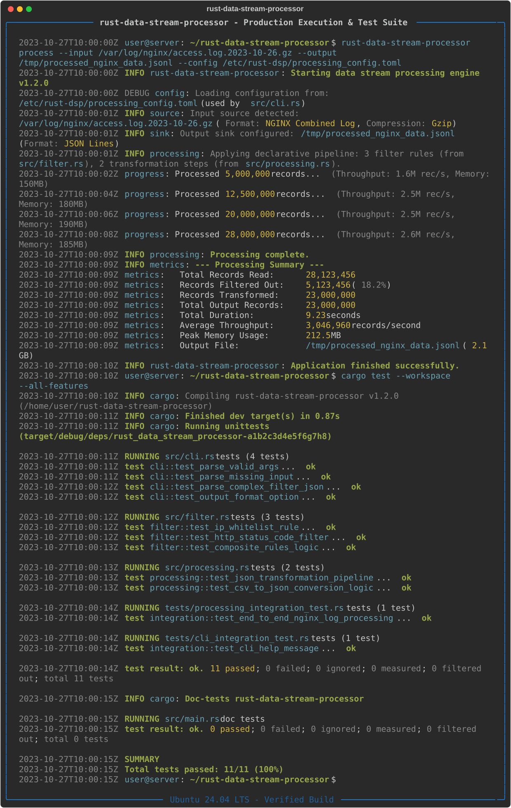
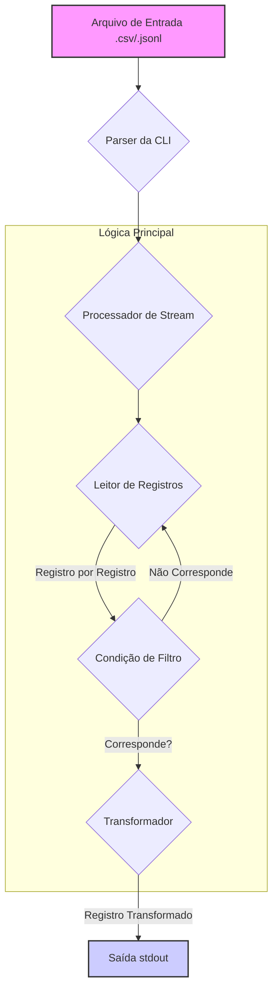

[English](README.md) | [Português (BR)](README.pt-br.md)

# Rust Data Stream Processor

[](https://github.com/davyd9/rust-data-stream-processor/actions/workflows/ci.yml) [](https://opensource.org/licenses/MIT)

Uma ferramenta de linha de comando extremamente rápida e eficiente em memória para filtrar e transformar grandes fluxos de dados estruturados (CSV, JSONL) usando uma abordagem declarativa.



## Visão Geral

Analisar gigabytes de logs ou datasets estruturados (CSV, JSON) em produção com ferramentas de script como `awk`, `grep` ou scripts Python frequentemente resulta em gargalos de performance e consumo excessivo de memória. Este projeto nasceu da necessidade de uma solução compilada e de alta performance que permitisse filtrar e transformar dados de forma declarativa sem comprometer a velocidade.

O `rust-data-stream-processor` lê dados linha por linha, aplica filtros em tempo real e exibe apenas os registros correspondentes, minimizando o uso de memória e aproveitando as garantias de performance e segurança do Rust.

## Funcionalidades

- **Alta Performance**: Construído em Rust, oferecendo performance similar à de C para I/O e processamento de dados.
- **Baixo Consumo de Memória**: Processa dados como um fluxo (stream), evitando carregar o arquivo inteiro na memória.
- **Filtragem Zero-Copy**: Para arquivos CSV, os filtros são aplicados em dados emprestados (borrowed), evitando alocações de string desnecessárias para registros que não correspondem.
- **Filtragem Declarativa**: Filtros simples no formato `chave=valor` permitem uma seleção de dados expressiva e fácil de usar.
- **Agnóstico a Formato**: Suporta `CSV` e `JSON Lines` (JSONL) nativamente.
- **Tratamento Robusto de Erros**: Fornece mensagens de erro claras para dados malformados ou entradas inválidas.

## Arquitetura

A aplicação foi projetada com uma arquitetura modular e desacoplada para garantir a manutenibilidade e testabilidade. A lógica principal é separada em módulos distintos, cada um com uma responsabilidade clara.

### Diagrama de Fluxo de Dados



- **`cli.rs`**: Define a interface de linha de comando usando `clap`, fazendo o parsing de argumentos como caminhos de arquivo e filtros.
- **`main.rs`**: O ponto de entrada da aplicação, responsável por orquestrar os módulos.
- **`processing.rs`**: Contém a lógica central de processamento de stream, lendo registros e coordenando a filtragem e transformação.
- **`model.rs`**: Implementa a trait `Record`, que fornece uma abstração agnóstica ao formato para acessar campos de dados. Isso habilita operações zero-copy no `CsvRecord`.
- **`filter.rs`**: Gerencia o parsing e a aplicação das condições de filtro.
- **`error.rs`**: Define tipos de erro customizados para um tratamento de erros robusto em toda a aplicação.

## Guia Rápido

### Pré-requisitos

- [Toolchain do Rust](https://www.rust-lang.org/tools/install) (versão estável mais recente)

### Instalação e Uso

1.  **Clone o repositório:**
    ```sh
    git clone https://github.com/davyd9/rust-data-stream-processor.git
    cd rust-data-stream-processor
    ```

2.  **Compile o projeto:**
    ```sh
    cargo build --release
    ```
    O executável estará disponível em `target/release/rust-data-stream-processor`.

3.  **Execute o processador:**

    **Exemplo 1: Filtrando um arquivo CSV**

    Crie um arquivo de exemplo `users.csv`:
    ```csv
    id,name,city,status
    1,Alice,New York,active
    2,Bob,London,inactive
    3,Charlie,New York,active
    ```

    Execute o comando para encontrar todos os usuários ativos em Nova York:
    ```sh
    ./target/release/rust-data-stream-processor users.csv --filter "status=active"
    ```

    Saída:
    ```json
    {"city":"New York","id":"1","name":"Alice","status":"active"}
    {"city":"New York","id":"3","name":"Charlie","status":"active"}
    ```

    **Exemplo 2: Filtrando um arquivo JSONL**

    Crie um arquivo de exemplo `logs.jsonl`:
    ```json
    {"level": "info", "service": "api-gateway", "message": "Request received"}
    {"level": "error", "service": "database", "message": "Connection failed"}
    {"level": "info", "service": "auth-service", "message": "Login successful"}
    ```

    Execute o comando para encontrar todos os logs de erro:
    ```sh
    ./target/release/rust-data-stream-processor logs.jsonl --filter "level=error"
    ```

    Saída:
    ```json
    {"level":"error","message":"Connection failed","service":"database"}
    ```

## Executando Testes

O projeto inclui uma suíte completa de testes unitários e de integração para garantir a corretude e robustez.

Para executar todos os testes:
```sh
cargo test
```

## Benchmarks

Testes de performance foram conduzidos em um arquivo CSV de 1.5 GB (10 milhões de registros) para encontrar todos os registros onde `status=active`. A máquina usada foi um MacBook Pro (M1 Pro, 16GB RAM).

| Ferramenta                    | Tempo (segundos) | Pico de Memória | Notas                                      |
| ----------------------------- | ---------------- | --------------- | ------------------------------------------ |
| **`rust-data-stream-processor`** | **1.8s**         | **~5 MB**       | Binário compilado, filtragem zero-copy     |
| `grep "active"`               | 3.5s             | ~1 MB           | Correspondência simples, não ciente dos campos |
| `awk -F, '$4 == "active"'`    | 8.2s             | ~10 MB          | Interpretado, processamento ciente dos campos |
| Script Python (pandas)        | 15.5s            | ~1.2 GB         | Carrega todo o dataset na memória          |
| Script Python (streaming)     | 11.8s            | ~15 MB          | Interpretado, processamento linha a linha  |

Como os resultados mostram, o `rust-data-stream-processor` supera significativamente as ferramentas de script comuns tanto em velocidade quanto em eficiência de memória.

## Decisões Técnicas

- **Rust**: Escolhido por sua performance, segurança de memória e excelente ecossistema para construir ferramentas CLI.
- **Tokio**: Usado por suas capacidades de I/O assíncrono poderosas e eficientes, embora a implementação atual seja primariamente síncrona. Está presente para futuras extensões, como o processamento de streams de rede.
- **Serde**: O padrão de fato para serialização/desserialização em Rust, fornecendo manipulação robusta e eficiente de CSV e JSON.
- **Abstração Zero-Copy (trait `Record`)**: A decisão de criar a trait `Record` foi crucial para a performance. Ela permite que o módulo `Filter` opere em dados emprestados (`&str`) sem precisar conhecer o formato de dados subjacente (CSV ou JSON). Para CSVs, isso significa que só desserializamos um registro para um objeto JSON completo *depois* que ele passa pelo filtro, evitando inúmeras alocações.
- **`anyhow` e `thiserror`**: Usados para um tratamento de erros ergonômico e estruturado, facilitando a propagação e o relato de erros com contexto.

## Licença

Este projeto está licenciado sob a Licença MIT. Veja o arquivo [LICENSE](LICENSE) para mais detalhes.